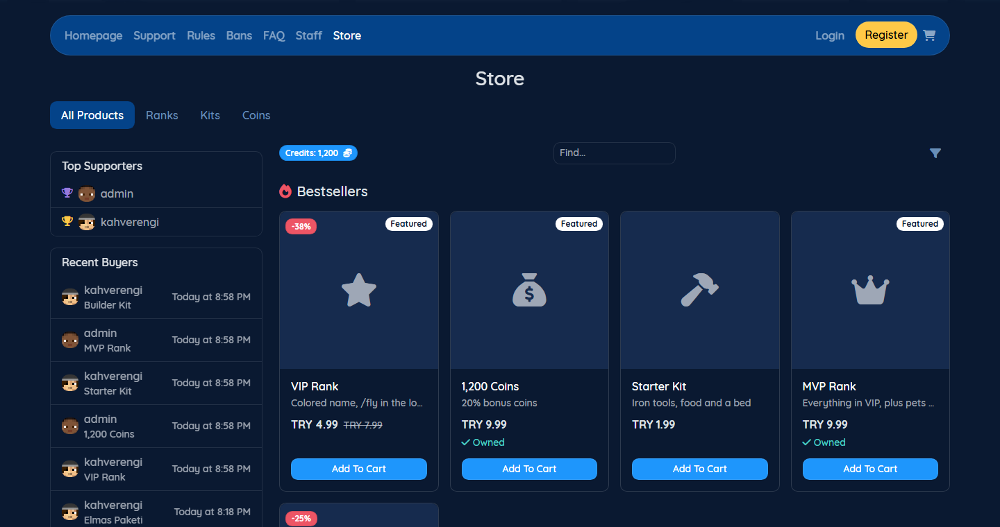
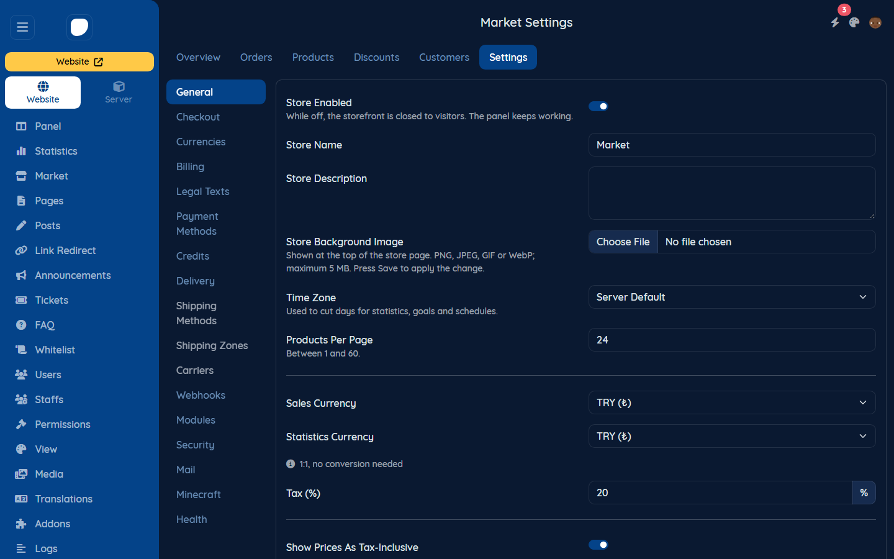

  
  <h1>Pano Market</h1>
  
<b>A complete store for your Minecraft server: sell ranks, kits and coins, and deliver them in game the moment they are paid.</b>

  

    
    
    
  

  

    
    
    
  

Pano Market turns your Pano website into a real store. Players browse your products, pay with the methods you choose or with store credits, and get their rank, items or coins on your server right away, even if they were offline when they paid. You run everything from the Pano panel: products, orders, refunds, discounts, invoices and statistics.

<h3 align="center">Features</h3>

- 🛒 **A full storefront**: Categories, search, featured products, sale prices, a cart and a one-page checkout.
- ⚡ **Instant delivery**: Commands, ranks, items and coins reach your game server the second a purchase is paid.
- 💤 **Offline players covered**: A purchase for someone who is offline waits and is delivered when they join.
- 🪙 **Store credits**: Sell coin packs, let players pay with credits, and give cashback on purchases.
- 🔁 **Subscriptions**: Monthly ranks that renew on their own and end cleanly when the player stops paying.
- 🎁 **Gifts**: Players buy a product for a friend, who gets a message in game when it arrives.
- 🏷️ **Discounts that sell**: Coupons, creator codes, sales, bundles, tiered upgrades and store-wide promotions.
- 🧾 **Orders and refunds**: Full order history, partial refunds, automatic take-back of what was delivered, PDF invoices.
- 📦 **Physical products too**: Shipping zones, shipping methods and carriers for merch.
- 🎮 **In game**: `/store`, `/store history`, `/credits`, a chest menu, purchase announcements and PlaceholderAPI placeholders.
- 🌍 **Speaks your players' language**: In-game messages follow the language each player picked on your website.
- 📊 **Know your numbers**: Revenue, top products, payment methods and currencies on the overview page.

<h3 align="center">Screenshots</h3>

<i>Every product has its own page with sale prices, quantity and one-click buying.</i>

<i>Revenue and the latest orders at a glance in your panel.</i>

<i>Add products and decide what each one does: run commands, give a rank, add coins or call a webhook.</i>

<i>Checkout, currencies, billing, payment methods, credits, delivery and shipping, all in one place.</i>

<h3 align="center">Get started</h3>

1. Open your Pano panel and go to **Addons**.
2. Find **Pano Market** and click **Install**.
3. Turn on a payment method under **Market > Settings** (bank transfer and credits are built in, card gateways are addons), then create your first products under **Market > Products**.
4. To deliver to a game server, install the Market plugin on it (see below).

<h3 align="center">On your Minecraft server</h3>

Deliveries run through a small plugin on each server, next to [pano-mc-plugin](https://github.com/PanoMC/pano-mc-plugin/releases) **1.2.0 or newer**. Download the right one from **Market > Servers** in your panel (it always matches your Market version) or from the [releases](https://github.com/PanoMC/pano-plugin-market/releases), and drop it into the server's `plugins` (or `mods`) folder:

| Server | File |
|---|---|
| Paper, Spigot, Folia, Purpur | `pano-plugin-market-spigot-<version>.jar` |
| BungeeCord, Waterfall | `pano-plugin-market-bungee-<version>.jar` |
| Velocity | `pano-plugin-market-velocity-<version>.jar` |
| Fabric | `pano-plugin-market-fabric-<version>.jar` |

<h3 align="center">Payment methods and shipping</h3>

Bank transfer and store credits are built in. Card payments and other gateways, and every shipping carrier, are separate addons you install next to Market, so you only add what your store needs. Developers can build their own against the Market API jar (`pano-plugin-market-api-<version>.jar`, attached to every release) and the [payment](https://github.com/PanoMC/pano-plugin-market-payment-template) and [shipping](https://github.com/PanoMC/pano-plugin-market-shipping-template) templates.

<h3 align="center">For developers</h3>

Needs JDK 21, Bun and the Gradle wrapper. `./gradlew build -Pfabric` builds the plugin jar (`build/libs`), the API jar (`build/api`) and the Minecraft jars (`build/mc`; the Fabric one only with `-Pfabric`). The database test tier needs MariaDB (`PANO_IT_MARIADB`). Releases are made by CI (semantic-release) on `dev` (prerelease) and `main`.

<h3 align="center">Support</h3>

Questions or ideas? Join our [Discord](https://panomc.com/discord) or visit [panomc.com](https://panomc.com).

<h3 align="center">License</h3>

Released under the MIT License.
