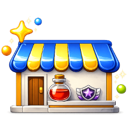
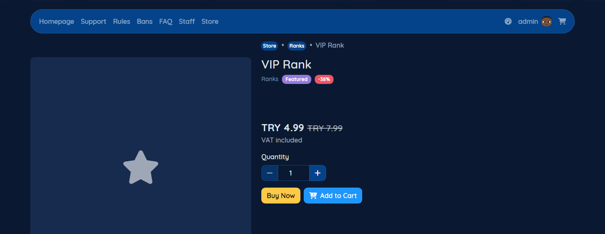
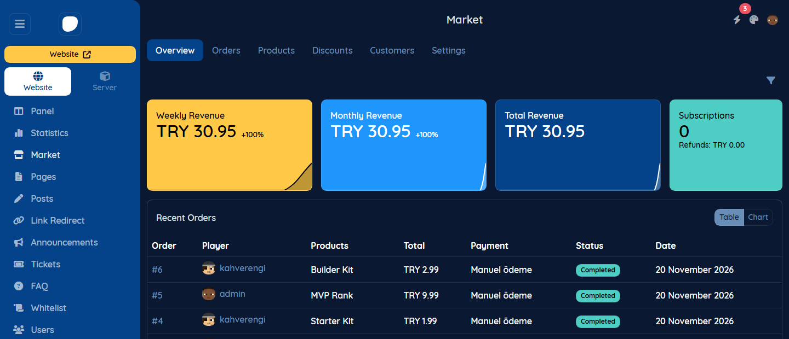
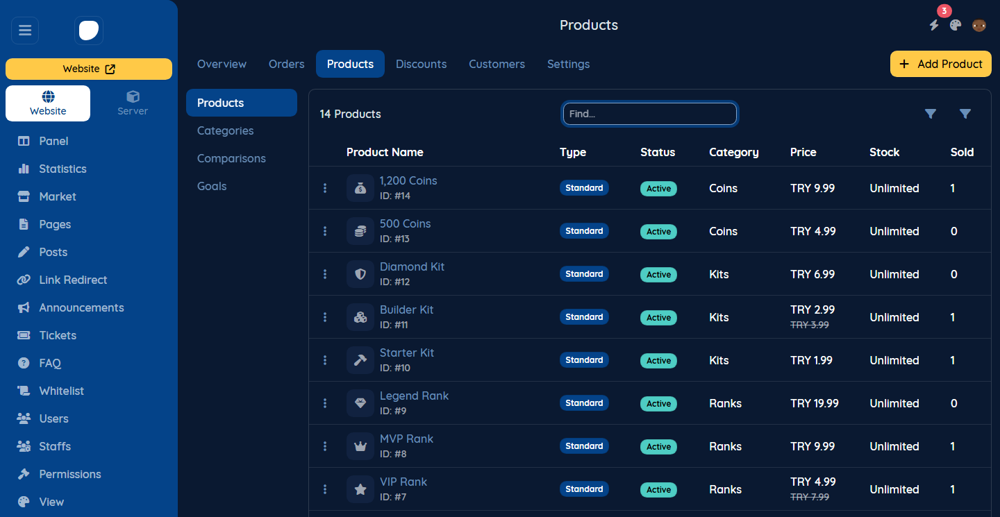

  
  <h1>Pano Market</h1>
  
<b>Open a store on your website and get paid for ranks, kits and coins. Players get what they bought in game right away.</b>

  

    
    
    
  

Pano Market adds a store to your Pano website. Your players pick what they want, pay, and receive it on your Minecraft server within seconds, even if they were offline at the time. You manage everything from your panel.

<h3 align="center">What you get</h3>

- 🛒 **Your own store**: Products in categories, sales, a cart and an easy checkout.
- ⚡ **Instant rewards**: Ranks, items and coins arrive in game as soon as the payment goes through.
- 🪙 **Store coins**: Sell coin packs and let players spend them in your store.
- 🔁 **Monthly ranks**: Subscriptions that renew by themselves.
- 🎁 **Gifts**: Players can buy something for a friend.
- 🏷️ **Coupons and sales**: Discount codes, creator codes and limited-time offers.
- 📊 **Clear numbers**: See your sales and best sellers at a glance.
- 🌍 **In your players' language**: Messages in game follow the language each player uses on your website.

<h3 align="center">Screenshots</h3>

<i>A clean page for every product.</i>

<i>Your sales and latest orders in your panel.</i>

<i>Add a product in a minute and choose what the player gets.</i>

<h3 align="center">Get started</h3>

1. Open your Pano panel and go to **Addons**.
2. Find **Pano Market** and click **Install**.
3. Under **Market > Settings**, choose how players pay. Bank transfer and store coins work right away; card payments come as separate addons.
4. Add your first products under **Market > Products**.

<h3 align="center">Game integration</h3>

To give players what they bought in game, put the **Pano Market Minecraft plugin** on your server, next to the [Pano plugin](https://github.com/PanoMC/pano-mc-plugin/releases/latest) (version 1.2.0 or newer).

| Your server | Minecraft versions | Download |
|---|---|---|
| Paper, Spigot, Folia, Purpur | 1.13 and newer | [Spigot file](https://github.com/PanoMC/pano-plugin-market/releases) |
| BungeeCord, Waterfall | Current versions | [BungeeCord file](https://github.com/PanoMC/pano-plugin-market/releases) |
| Velocity | Velocity 3 | [Velocity file](https://github.com/PanoMC/pano-plugin-market/releases) |
| Fabric | 26.1 and newer (with Fabric API) | [Fabric file](https://github.com/PanoMC/pano-plugin-market/releases) |

The easiest way: open **Market > Servers** in your panel and click **Download**. You always get the file that matches your store. Put it in your server's `plugins` folder (`mods` on Fabric) and restart the server.

<h3 align="center">Support</h3>

Questions or ideas? Join our [Discord](https://panomc.com/discord) or visit [panomc.com](https://panomc.com).

<h3 align="center">License</h3>

Free and open source under the MIT License.
